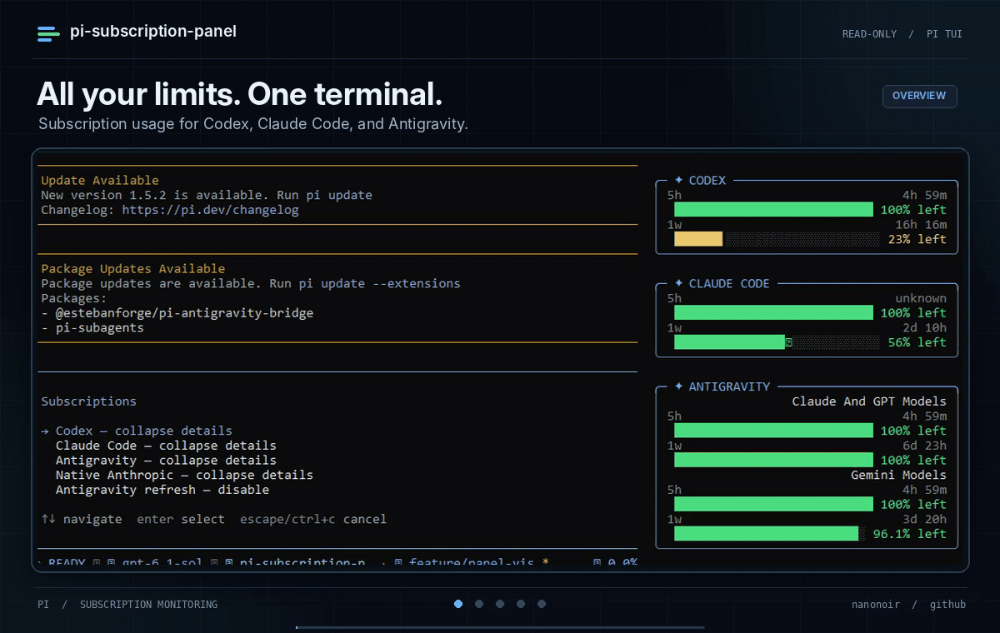

# Pi Subscription Panel

**Your subscription limits, at a glance. Without leaving Pi.**

Read-only quota panels for [Pi](https://pi.dev/) and
[Pi Atelier](https://github.com/michaelmjhhhh/pi-atelier): Codex, Claude Code,
Antigravity, and native Anthropic OAuth.

[](https://github.com/nanonoir/pi-subscription-panel/releases/tag/v1.0.0)
[](https://github.com/nanonoir/pi-subscription-panel/blob/main/LICENSE)
[](https://nodejs.org/)



## What you get

- **Remaining quota**, not usage math: progress bars, `% left`, and reset countdowns.
- **Independent panels** with five-hour and weekly windows when the provider reports them.
- **Automatic reads**, conservative refresh intervals, and clear failure diagnostics.
- **Reload continuity** for Codex, Claude Code, and Antigravity: last readings stay
  visible without bypassing refresh limits.
- **No inference requests** to measure quota. Your model routing stays unchanged.

## Install

Requires **Node.js 22+**, Pi, and Pi Atelier.

```sh
pi install https://github.com/nanonoir/pi-subscription-panel
```

Restart Pi, then open **Atelier Settings → Display**, enable the panels you want,
and choose **Save default**. New panels may start hidden. If the sidebar is short
on space, enlarge the terminal or hide other panels.

> **Use one copy.** Disable the old `pi-subscription-limits` resources in
> `pi config`, if installed. Do not also load this extension with `-e` after
> installing it. Keep Atelier and your provider extensions enabled.

**npm publication is coming next.** This Git release is installable now; no npm
package installation is advertised until publication is complete.

## Connect your existing subscriptions

| Provider             | Quota source                               | Setup                                                                                                     |
| -------------------- | ------------------------------------------ | --------------------------------------------------------------------------------------------------------- |
| **Codex**            | Pi's `openai-codex` OAuth session          | Sign in to that provider in Pi. This does not change your execution provider or model.                    |
| **Claude Code**      | Claude Code's existing local OAuth session | Sign in through Claude Code. The panel reads at startup and accepts quota metadata from normal responses. |
| **Antigravity**      | Existing `agy /usage` CLI bridge           | Have the bridge available, then enable refresh in `/subscriptions`. It is **off by default**.             |
| **Native Anthropic** | Pi's native Anthropic OAuth session        | Optional, separate from Claude Code. Hide this panel if you do not use that session.                      |

Panel visibility and acquisition are separate: **Atelier Display** shows or hides
a panel; `/subscriptions` controls details and Antigravity refresh.

## Controls

Open `/subscriptions` for the menu. Enabled panels otherwise work without commands.

| Command                                  | Action                                                                  |
| ---------------------------------------- | ----------------------------------------------------------------------- |
| `/subscriptions toggle codex`            | Expand or collapse Codex details                                        |
| `/subscriptions toggle claude-code`      | Expand or collapse Claude Code details                                  |
| `/subscriptions toggle antigravity`      | Expand or collapse Antigravity details                                  |
| `/subscriptions refresh antigravity on`  | Enable automatic Antigravity reads                                      |
| `/subscriptions refresh antigravity off` | Disable reads and discard retained Antigravity quota                    |
| `/subscriptions status`                  | Show sanitized scheduling and failure diagnostics; **makes no request** |
| `/subscriptions retry claude-code`       | Request a retry, subject to existing safety limits                      |

Retry also accepts `codex`, `antigravity`, and `anthropic`. To pause acquisition
for collapsed panels, use `/subscriptions refresh collapsed off`; use `on` to
restore the default behavior. Preferences are saved in Pi's agent directory.

## Refresh and reload

| Provider         | Minimum interval between attempts                    |
| ---------------- | ---------------------------------------------------- |
| Codex            | 1 minute                                             |
| Claude Code      | 5 minutes                                            |
| Antigravity      | 3 minutes when recently active; 20 minutes when idle |
| Native Anthropic | 30 minutes                                           |

These are **minimum gaps, not guaranteed update intervals**. Server deadlines,
failure backoff, and the local one-minute tick can delay a read. Authentication
failures pause automatic reads until an explicit retry.

`/reload` restores retained readings with their **original observation times**.
It does not force another request. Retention is bounded, process-local, and never
written to disk. Closing Pi discards it. Native Anthropic does not retain quota
across reloads.

> **Antigravity assumes one account per Pi process.** Close and reopen Pi after
> switching Antigravity accounts; reload alone cannot detect that change.

Missing data is never estimated. Old readings are marked as stale, and independent
quota pools remain separate. A reset countdown describes the provider's window,
not the time of the next refresh.

## Privacy and compatibility

- No messages are sent to a model solely to obtain quota.
- Credentials and account identifiers are not shown in the panels or diagnostics,
  or stored in panel preferences. Existing provider authentication stays intact.
- Claude Code uses only its own `~/.claude/.credentials.json`: no alternate
  credential fallback, token renewal, or extra CLI invocation for that reader.
- Quota endpoints are undocumented interfaces and can change. Unsupported or
  partial responses are reported honestly rather than replaced with fake values.

For a waiting or failed panel, start with `/subscriptions status`. It distinguishes
normal refresh gaps, failure backoff, server deadlines, and manual-retry blocks
without making another quota request.

## Development

Pi loads the TypeScript extension directly; there is no build step.

```sh
npm ci
npm run check
pi -e ./extensions/index.ts
```

Use the temporary `-e` command **instead of** loading an installed copy.
See the [development guide](https://github.com/nanonoir/pi-subscription-panel/blob/main/docs/DEVELOPMENT.md)
and [contributing guide](https://github.com/nanonoir/pi-subscription-panel/blob/main/CONTRIBUTING.md).

## License

[MIT](https://github.com/nanonoir/pi-subscription-panel/blob/main/LICENSE).

## Acknowledgements

Thanks to [Alexmarco](https://github.com/alexmarco) for the original
[pi-subscription-limits](https://github.com/alexmarco/pi-subscription-limits),
on which this project is based.
